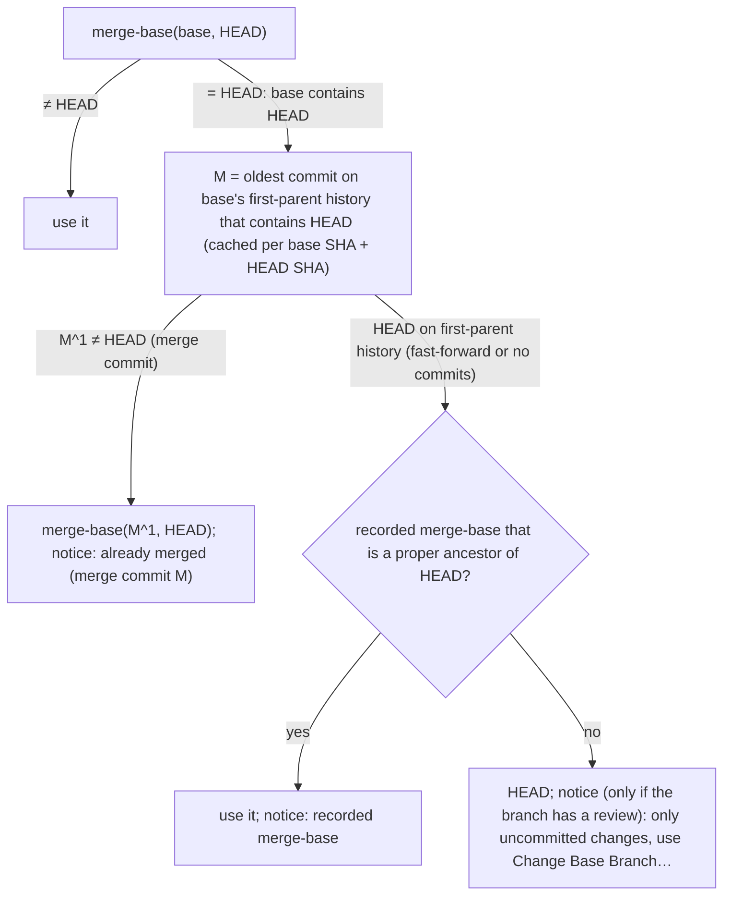

# Merge-base: keep a merged branch's diff, accept a commit as the base, record reviewed commits

## Planning

User's request (relayed by the coordinating agent, verbatim):

> Repo: D:\branch-review-studio (VS Code extension "Branch Review Studio", plus its MCP server in
> src/mcp and the review skill in skills/branch-review-studio/SKILL.md). Follow the TPP and
> conventions in AGENTS.md / CLAUDE.md there (including the Transcripts/ convention). Work on
> `main`.
>
> Background: the extension diffs the working tree against the merge-base `git merge-base
> <baseRef> HEAD`, where baseRef is `origin/<base>` if it exists, else `<base>` (base is usually
> `develop`). The review (JSON file) has a base branch; groups record the merge-base they were
> posted against (and now `ChangeGroups.baseRef`).
>
> David (the user) reports: "without changing the current branch, when it's merged in to the base
> branch, looks like I lose access to the diff. I wanted to get the diff back by changing the base
> branch (develop) to its old hash but this didn't work." He wants:
>
> 1. **Detect a merged branch.** When the base already contains HEAD (`git merge-base
>    --is-ancestor HEAD <baseRef>`), the merge-base is HEAD and the diff is empty. In that case
>    diff against the base as it was before the branch was merged, i.e. the last base commit that
>    had been merged into the branch. Suggested algorithm (verify it, and handle the variants):
>    walk the base's first-parent chain (`git rev-list --first-parent <baseRef>`) to find the
>    oldest first-parent commit M that contains HEAD; if M is a merge whose non-first parent
>    contains HEAD, use `merge-base(M^1, HEAD)` as the merge-base. For a fast-forward merge (HEAD
>    itself is on the first-parent chain) there's no merge commit; then fall back to the
>    merge-base recorded by the review (item 3), and if none, show a clear notice. Squash merges
>    don't make HEAD an ancestor, so they don't trigger this (the normal merge-base still works) —
>    confirm. Show a notice in the sidebar saying the branch is already merged into `<base>`
>    (merge commit short SHA) and the diff is against `<old merge-base>`, the base as it was
>    before the merge. Keep the cost reasonable (this runs on refresh; limit the rev-list, cache
>    by (baseRef sha, HEAD sha)). Make sure everything that uses the merge-base (diffs, groups'
>    staleness check, MCP `review_begin` which agents use, comment line mapping, the base content
>    provider) gets the same effective merge-base — find the single place it's computed.
>
> 2. **Base can be a commit hash (or any commit-ish).** Find why **Change Base Branch…** didn't
>    accept a hash (probably prepends `origin/` or validates against the branch list) and allow a
>    SHA / tag / any rev that `git rev-parse --verify <rev>^{commit}` accepts. With a SHA, don't
>    try `origin/<sha>`; the merge-base is `merge-base(<sha>, HEAD)`. Make the UI say it accepts a
>    commit too (e.g. quick pick with branches plus a "Use commit or ref…" input, or accept typed
>    text). The MCP `review_begin` `baseBranch` parameter and the skill's `--base` should accept
>    the same. Check the "git fetch origin <base>" step in the skill doesn't break with a SHA (tell
>    it to skip fetching when base isn't a branch).
>
> 3. **Record the reviewed commits.** When an agent reviews (review_begin, and/or review_finish /
>    review_set_groups — pick what's sensible and say why), the MCP server should store in the
>    review file the base ref and its SHA, the merge-base SHA and the HEAD SHA at the time (record
>    it server-side automatically; don't rely on the agent passing hashes — but update the skill
>    text if it should mention it). The extension should use these reasonably, at least: (a) as
>    the fallback merge-base in item 1, and (b) showing in the sidebar which commit was reviewed
>    and, if HEAD has moved since, e.g. "N commits since the review" (cheap: `git rev-list --count
>    <reviewedHead>..HEAD`, handle the reviewed commit no longer existing after a rebase). If
>    there's another clearly useful use (e.g. a "Changes since review" diff command), propose it
>    in your report rather than building it. Keep old review files (without these fields) working.
>
> Testing: write tests first; develop against `npx tsc --noEmit` and `npx vitest run`. For
> git-algorithm tests, build small temp repos in tests if the existing tests do that (check),
> covering: merge commit (no-ff) into develop, fast-forward merge, squash merge, develop merged
> into the branch several times before the branch got merged, and base given as a SHA. Keep VS
> Code test launches rare (each pops a window over David's work): run the smoke test at most ONCE
> at the end, and report the name of any failing check (a Ctrl+Enter check failing when the window
> lacks focus is a known flake).
>
> When done: commits (style like the existing log; end each commit message with "Co-Authored-By:
> Claude Opus 5.5 <noreply@anthropic.com>"), then `npm run package` and `code --install-extension
> <the vsix> --force`. Don't bump the version, push, or release. Since the bundled skill changes,
> the extension's auto-update will refresh the installed skill copies on next start — confirm
> that's true for the change you made. Report: commit hashes, how each item works (including the
> notice wording), test results, and anything left open.

Findings:

- F1: `findMergeBase` (src/core/git.ts) is the single place that computes the merge-base. The
  extension calls it in `BranchReviewModel.computeSnapshot` and `changeBaseBranch` (which Fetch
  Base Branch also uses); the MCP server calls it in `ReviewTools.beginReviewCore` (review_begin,
  review_set_groups, and review_comment when there is no review). Diffs, the base content
  provider, comment threads on the base side, group staleness (`arrangeGroups`) and Ask Agent
  prompts all read the snapshot's or the review's `mergeBaseSha`.
- F2: Why the old hash didn't work: `findBaseRef` already accepted any revision as a last resort
  (after `origin/<x>` and `refs/heads/<x>`), but there was no way to enter one. **Change Base
  Branch…** was a `showQuickPick` of branch names only; the settings panel offers a `<select>` and
  rejects values not in it; and the `branchReviewStudio.baseBranch` setting applies only to
  branches without a review (a review's own `baseBranch` wins).
- F3: The suggested algorithm is the one git-when-merged uses. Commits on the base's first-parent
  history that contain HEAD form a contiguous newest-first run, so the oldest one, M, is the last
  first-parent commit that is also in `git rev-list --ancestry-path HEAD..<base>`. If M's first
  parent is HEAD, HEAD is on the first-parent history (fast-forward, or a branch without commits
  of its own); otherwise M is a merge and `git merge-base M^1 HEAD` is the last base commit the
  branch had merged.
- F4: A branch that has no commits of its own yet (just created from develop, develop moved on)
  looks exactly like a fast-forward-merged branch: HEAD is on develop's first-parent history.
- F5: A squash merge leaves HEAD outside the base's history, so the normal merge-base still works
  (tested).
- F6: The extension already refreshes the installed `SKILL.md` copies and
  `~/.branch-review-studio/mcp-server.js` on activation when their contents differ
  (`updateInstalledFilesIfOutdated`), and the vsix includes both, so this change reaches installed
  agents on the next VS Code start (running agent sessions keep their old server process until
  restarted).

## Questions and assumptions

No questions were asked: the run was non-interactive (a subagent of the coordinating agent).
Decisions made without confirmation:

- D1 (assumed): `findMergeBase(repoRoot, baseBranch, recordedMergeBases)` takes the review's
  recorded merge-bases (`getRecordedMergeBases(review)` = `reviewedCommits.mergeBaseSha`, then
  `mergeBaseSha`); both the extension and the MCP server pass them, so all consumers get the same
  merge-base. `review.mergeBaseSha` is included so that review files written by 1.1.0 benefit too.
- D2 (assumed): merge detection runs only when the merge-base is HEAD, with two `rev-list` calls
  (`--first-parent --parents --max-count=10000` and `--ancestry-path`, both over `HEAD..<base>`),
  cached per (base SHA, HEAD SHA) in a 100-entry map. The normal path costs one extra
  `git rev-parse HEAD`.
- D3 (assumed): because of F4, the "already contains HEAD, only uncommitted changes" notice (no
  merge commit, no usable recorded merge-base) appears only if the branch has a review; a fresh
  branch without a review shows nothing extra.
- D4 (assumed): a base that resolves to a commit whose SHA starts with the typed text, or that
  contains characters a branch name can't have (e.g. `develop~3`, `HEAD^`, `x@{1}`), is used
  as-is, without trying `origin/<x>`. Tags and other names still try `origin/<x>` and
  `refs/heads/<x>` first, as before. The base is stored as typed, not resolved to a full SHA.
- D5 (assumed): **Change Base Branch…** uses `createQuickPick`: branches plus an always-visible
  item "Use a commit or other ref…" (second, after the current base), which opens an input box
  prefilled with the text typed in the quick pick and validated with `git rev-parse --verify
  <rev>^{commit}`. The settings panel's `<select>` stays branch-only (it lists the current base,
  even a SHA).
- D6 (assumed): **Fetch Base Branch** says "The base is commit X, not a branch, so there is
  nothing to fetch." for a SHA base instead of running `git fetch origin <sha>`.
- D7 (assumed): `Review.reviewedCommits = { baseRef, baseSha, mergeBaseSha, headSha }` is recorded
  in `beginReviewCore`, i.e. by review_begin and review_set_groups (and review_comment if it
  creates the review): these are the moments the server computes the merge-base that the agent
  diffs against. Not in review_finish: it computes nothing, and an agent may skip it. The skill
  doesn't mention it, since agents need to do nothing.
- D8 (assumed): the sidebar shows the reviewed commit as a notice line, computed with
  `countCommitsSince` (`git rev-list --left-right --count <sha>...HEAD`) only when the reviewed
  HEAD differs from HEAD.
- D9 (assumed): one commit for all three items, since they share `findMergeBase`, the review
  tools and the view's notices.

Notice wording (view):

- Merge commit: "This branch is already merged into `origin/develop` (merge commit `abcd1234`),
  so the diff is against `ef567890`, the merge-base from before the merge."
- Fast-forward, recorded merge-base: "`origin/develop` already contains HEAD (e.g. after a
  fast-forward merge), so the diff is against `ef567890`, the merge-base that the review
  recorded."
- Fast-forward, none recorded (only with a review): "`origin/develop` already contains HEAD, so
  the diff shows only uncommitted changes: this branch was fast-forward merged into it, or has no
  commits of its own. To see a merged branch's changes, use Change Base Branch… to compare with
  the commit that `origin/develop` was at before the merge."
- Reviewed commit: "Reviewed commit `abcd1234` (the current HEAD)." / "Reviewed commit `abcd1234`;
  3 commits since the review." / "Reviewed commit `abcd1234`, which HEAD's history no longer
  contains (rebased or reset?)."

Plan (brief; not confirmed, see above):

- src/core/git.ts: `MergeBaseInfo` gains `baseSha`, `headSha` and `headInBase?: HeadInBaseInfo`;
  `findMergeBase` as in the diagram; new `countCommitsSince`, `tryGetCommitSha`, `isShaOf`;
  private `findMergeOfHead` (cached).
- src/core/review.ts: `ReviewedCommits`, `Review.reviewedCommits?`, `getRecordedMergeBases`.
- src/mcp/review-tools.ts / server.ts: record `reviewedCommits`; review_begin's result names the
  ref and explains a merged branch; tool descriptions mention commits and merged branches.
- src/core/review-view-html.ts, src/extension/model.ts, review-view.ts, settings-panel.ts: the
  notices and the reviewed-commit line.
- src/extension/change-base-branch.ts, diff-commands.ts: the commit input; no fetch for a SHA.
- skills/branch-review-studio/SKILL.md, docs/guide.md, package.json: `--base <branch or commit>`,
  fetch only branches, branch tracking for merged branches.
- Tests: git.test.ts (merge commit after develop was merged into the branch twice; fast-forward
  with and without recorded merge-bases; a branch without commits; squash merge; SHA, abbreviated
  SHA, tag and `develop~1` bases; `countCommitsSince`), review-tools.test.ts (records
  `reviewedCommits`; merged branch; SHA base), review-view-html.test.ts (notices).

## End phase

- Tests: written first; the 12 new tests failed before the implementation. `npx tsc --noEmit`
  passes; `npx vitest run` passes (21 files, 197 tests). An existing test ("setGroups freezes the
  hunks against the current merge-base") moved the merge-base by fast-forwarding develop to the
  branch, which now counts as a fast-forward merge; it now merges a new develop commit into the
  branch with `--no-ff` instead.
- Smoke test (`npm run smoke-test -- D:/brs-sandbox/Barreleye`): did not run. Both attempts exited
  at once with "Code is currently being updated. Please wait for the update to complete before
  launching." (VS Code's installer held its update lock), so no window opened. Its
  changeBaseBranch check now also switches to a commit SHA base.
- Second pass (subagent): simplified the search for M to one `findLastIndex`; corrected doc
  comments on `Review.reviewedCommits` and `ReviewedCommits`; made the settings panel's merge-base
  line state the reason itself; mentioned the merged-branch case in the `baseBranch` setting's
  description; made the skill's branch-tracking step say how to tell a merged branch from one
  without commits (`git log -1 <merge-base>..HEAD`); re-wrapped the guide. It found no functional
  bugs in the new code, and listed these issues:
  - C1 (fixed): `findBaseRef` tried `origin/<x>` first for revision expressions, so `HEAD~3`
    meant `origin/HEAD~3` (pre-existing, but the new input invites such text). Now covered by D4
    and a `develop~1` test case.
  - C2 (not fixed): `rev-list --ancestry-path HEAD..<base>` is not limited; it runs only when the
    base contains HEAD, and is cached, but again after each fetch moves the base.
  - C3 (not fixed): if a review was created while the branch had no commits and HEAD later
    fast-forwarded to a newer base commit, the recorded merge-base is still an ancestor of HEAD,
    so the diff shows the base's commits; the notice says the merge-base came from the review.
  - C4 (not fixed, low risk): SHAs read from the review file are passed to git without
    `--end-of-options`.
- Proposals (not built):
  - P1: a "Changes since review" command: multi-diff of `reviewedCommits.headSha` vs the working
    tree, to see what changed since the agent reviewed.
  - P2: let the settings panel's base selector accept a typed commit too (it is branch-only).
